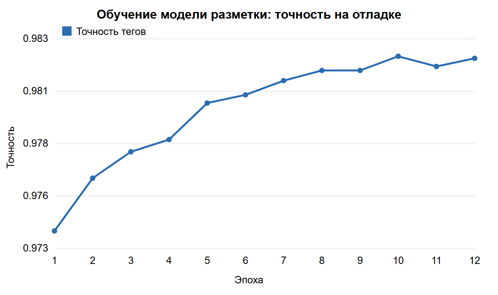
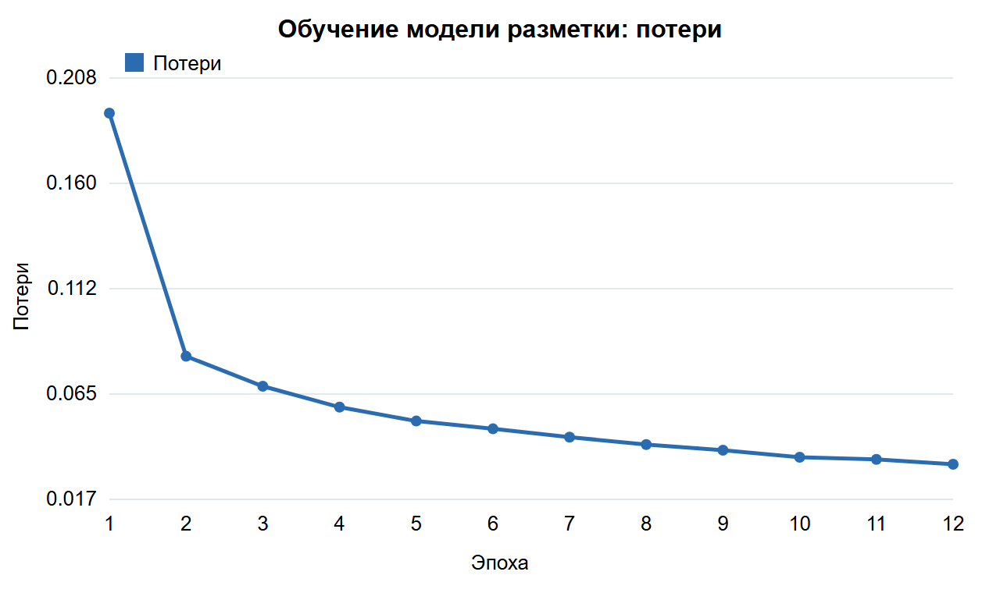
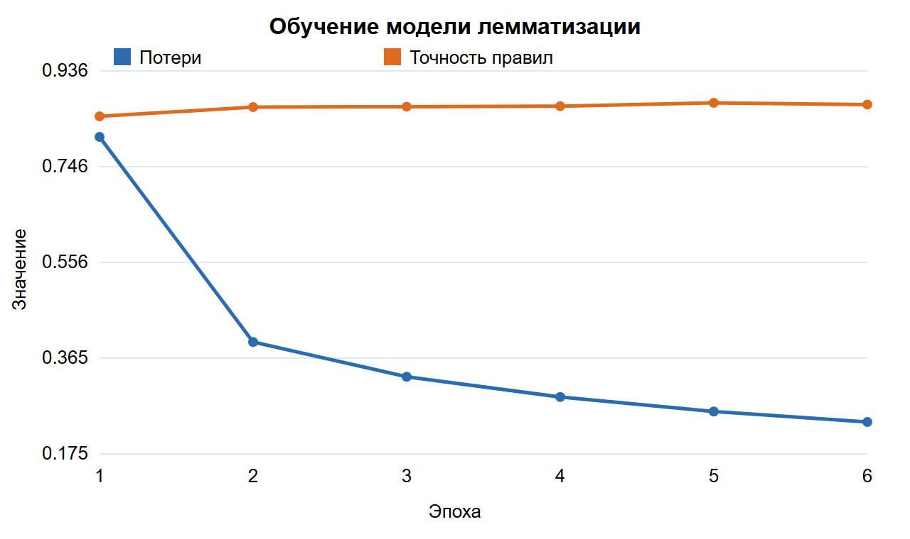
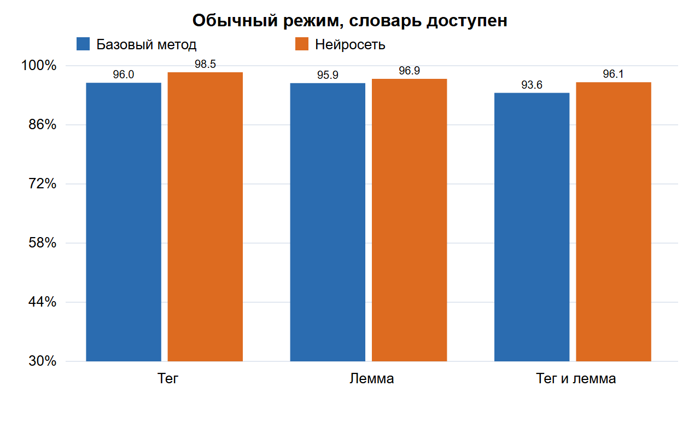
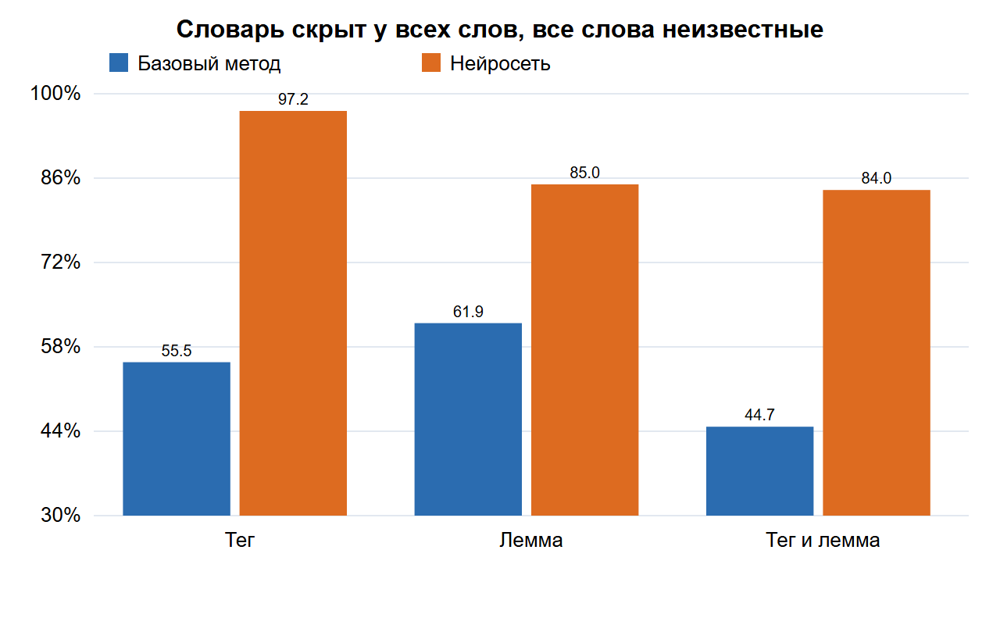
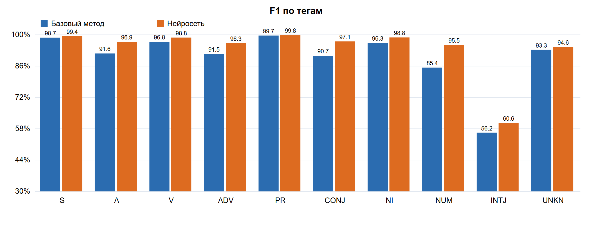
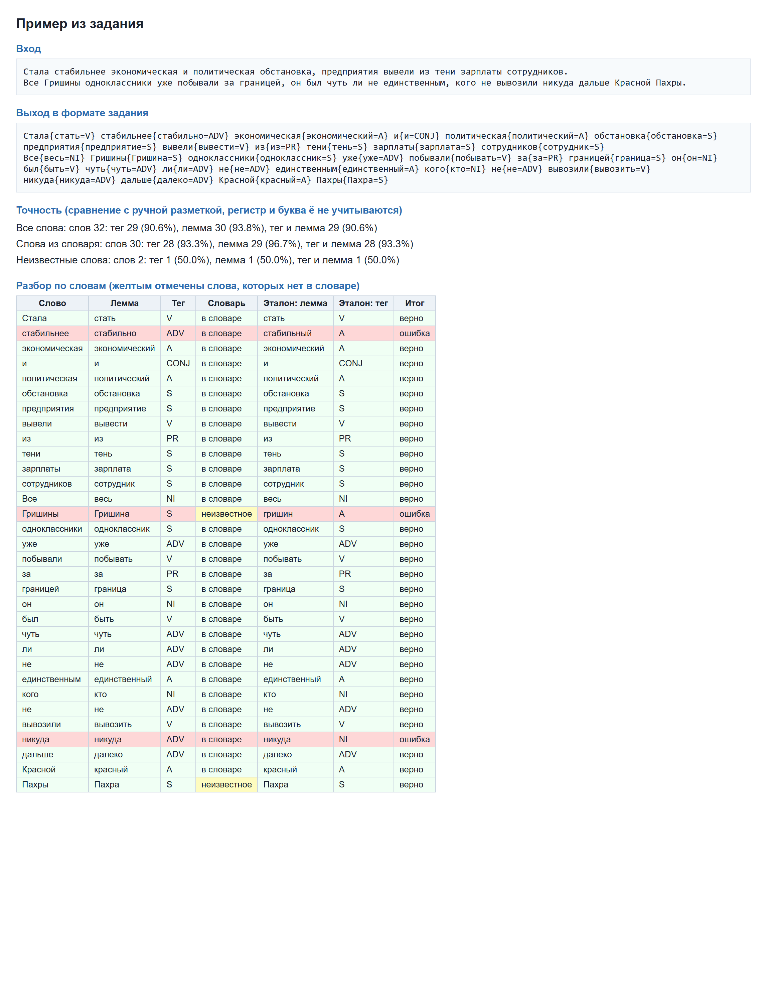
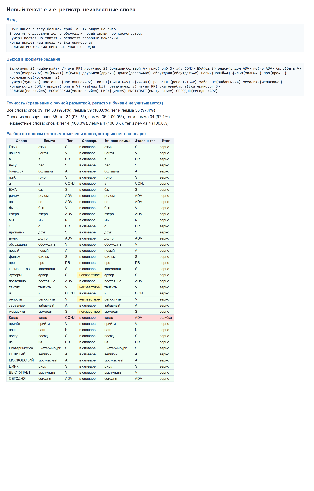

# Лабораторная работа 1. Лемматизация и частеречная разметка русского текста

## 1. Описание задания

Требуется привести слова текста к словарной форме (лемме) и приписать каждой лемме частеречный тег.

**Вход.** Предложения, по одному в строке. Слова разделены пробелами. Из знаков препинания допускаются только запятая, точка, вопросительный и восклицательный знаки.

**Выход.** Для каждого предложения строка, где после каждого слова в фигурных скобках записаны лемма и тег. Знаки препинания в выходной строке отсутствуют. Пример записи: `Стала{стать=V}`.

**Теги.** Используются теги из примера задания: `S` (существительное), `A` (прилагательное), `V` (глагол), `ADV` (наречие и частица), `PR` (предлог), `CONJ` (союз), `NI` (местоимение), `NUM` (числительное), `INTJ` (междометие), `UNKN` (прочее).

**Условия.**
- Буквы «е» и «ё» считаются одинаковыми.
- Заглавные и строчные буквы считаются одинаковыми.
- Нельзя использовать готовые морфологические анализаторы (mystem, pymorphy и подобные).
- Необходимо обрабатывать неизвестные слова и оценивать точность.

## 2. Описание решения

### 2.1. Данные

Использованы открытые данные (таблица 1).

*Таблица 1 – Использованные данные*

| Данные | Источник | Назначение |
|---|---|---|
| Корпус SynTagRus (Universal Dependencies) | github.com/UniversalDependencies/UD_Russian-SynTagRus | Обучение, отладка и проверка. У каждого слова есть лемма и часть речи |
| Таблица словоформ UniMorph для русского языка | github.com/unimorph/rus | Словарь изменяемых слов: существительных, прилагательных, глаголов |

Корпус уже разделён на три части: обучающая (69 631 предложение), отладочная (8 906) и тестовая (8 800 предложений, 128 086 слов). Тестовая часть при обучении и при сборке словаря не использовалась, поэтому оценка остаётся честной.

Части речи корпуса приведены к тегам задания: NOUN и PROPN – `S`; ADJ – `A`; VERB и AUX – `V`; ADV и PART – `ADV`; ADP – `PR`; CCONJ и SCONJ – `CONJ`; PRON и DET – `NI`; NUM – `NUM`; INTJ – `INTJ`; X – `UNKN`. Знаки препинания и символы пропускаются. Правила записаны в файле `lab1/tagset.py`.

### 2.2. Общая схема

Решение состоит из четырёх частей.

1. **Словарь словоформ.** Для каждой формы слова хранятся все возможные пары «лемма и тег». Словарь собран из слов обучающей части корпуса и из таблицы UniMorph. Всего в нём 375 510 словоформ. Буква «ё» заменяется на «е», регистр не учитывается.
2. **Выбор тега.** Слово может иметь несколько разборов (например, «стали» – глагол или существительное). Тег выбирает первая нейросеть по контексту предложения среди тегов, которые есть в словаре для этого слова.
3. **Лемма для известных слов** берётся из словаря. Если вариантов несколько, выбирается самый частый в корпусе.
4. **Лемма для неизвестных слов.** Если слова нет в словаре, вторая нейросеть выбирает правило: сколько букв отрезать в конце слова и что дописать.

У чисел лемма равна самому числу, а тег выбирает нейросеть, так как в корпусе годы размечены как прилагательные.

### 2.3. Модели

**Модель разметки.** Для каждого слова строится вектор из пяти частей: вектор слова, вектор по буквам (свёрточные фильтры), признаки регистра, вектор допустимых тегов из словаря и признак «слово есть в словаре». Затем двухслойная двунаправленная LSTM (размер 192) читает предложение, и для каждого слова выдаётся оценка каждого тега. Параметры: размер вектора слова 128, dropout 0,33, оптимизатор Adam, скорость обучения 0,002 с уменьшением в 0,9 раза после каждой эпохи, 12 эпох.

Чтобы модель умела работать с неизвестными словами, при обучении у 12% слов скрывается разбор из словаря, а ещё у 10% слов заменяется само слово.

**Модель лемматизации.** Полносвязная сеть (два скрытых слоя по 512). Вход: последние 12 букв слова и тег. Обучается на парах «форма и лемма» из словаря: 372 672 примера, 795 разных правил. Обучение длится 6 эпох.

**Базовый метод для сравнения.** Из словаря берётся самый частый разбор слова. Для слов без словаря тег и лемма угадываются по окончанию. Нейросети не используются.

Обучение выполнялось на видеокарте NVIDIA GeForce MX550 (2 ГБ). Одна эпоха первой модели занимала около 1,7 минуты. Чтобы не переполнять память, пакеты составляются из предложений близкой длины, не более 1500 слов в пакете.

### 2.4. Структура проекта и запуск

| Файл | Назначение |
|---|---|
| `lab1/tagset.py`, `config.py`, `cli.py` | Теги, параметры и команды |
| `lab1/prepare/` (`data_download`, `corpus`, `dictionary`, `resources`) | Скачивание, чтение корпуса и сборка словаря |
| `lab1/train/` (`features`, `batching`, `model`, `lemma_rules`, `loop`) | Признаки, модели, обучение |
| `lab1/analyze/lemmatizer.py` | Итоговый разбор текста |
| `lab1/eval/` (`baseline`, `evaluation`, `report`, `render`, `demo`) | Базовый метод, оценка, таблицы и примеры |
| `lab1/examples/` | Входные тексты и эталонная разметка примеров |

Команды выполняются в консоли из папки проекта:

```
.venv\Scripts\python.exe -m lab1 prepare    # разбор данных, создаёт кэш
.venv\Scripts\python.exe -m lab1 train      # обучение обеих моделей, создаёт lab1/data/models/lab1_model.pt
.venv\Scripts\python.exe -m lab1 evaluate   # оценка на тестовой части
.venv\Scripts\python.exe -m lab1 report     # таблицы и графики в папку lab1/results
.venv\Scripts\python.exe -m lab1 demo       # обработка примеров из папки lab1/examples с картинками
.venv\Scripts\python.exe -m lab1 run --input вход.txt --output выход.txt
```

Команды `prepare`, `train` и `evaluate` сохраняют свой вывод в журналы `lab1/data/logs/*.log`, по которым команда `report` строит таблицы и графики. Данные скачиваются командой `download` или кладутся вручную в папку `lab1/data/raw`. Для запуска нужны Python 3.12 и PyTorch (для работы на видеокарте нужна сборка с CUDA).

## 3. Анализ результатов обучения

### 3.1. Ход обучения

Результаты по эпохам приведены в таблице 2. Потери стабильно уменьшаются, а точность тегов на отладочной выборке растёт с 97,39% до 98,24% (рисунки 1 и 2). После восьмой эпохи рост почти прекращается, снижения точности нет, значит, переобучения не наблюдается.

*Таблица 2 – Обучение модели разметки (отладочная выборка)*

| Эпоха | Потери | Точность тегов |
|---|---|---|
| 1 | 0,1921 | 97,39% |
| 2 | 0,0817 | 97,65% |
| 3 | 0,0681 | 97,78% |
| 4 | 0,0586 | 97,84% |
| 5 | 0,0523 | 98,02% |
| 6 | 0,0488 | 98,06% |
| 7 | 0,0450 | 98,13% |
| 8 | 0,0416 | 98,18% |
| 9 | 0,0391 | 98,18% |
| 10 | 0,0359 | 98,25% |
| 11 | 0,0349 | 98,20% |
| 12 | 0,0327 | 98,24% |



*Рисунок 1 – Точность модели разметки на отладочной выборке по эпохам*



*Рисунок 2 – Потери модели разметки по эпохам*

Вторая модель (лемматизация неизвестных слов) за шесть эпох достигла точности выбора правила 86,96% на контрольной части (таблица 3, рисунок 3). Лучшее значение, 87,29%, получено на пятой эпохе. Дальнейшее обучение заметного выигрыша не даст.

*Таблица 3 – Обучение модели лемматизации неизвестных слов*

| Эпоха | Потери | Точность правил |
|---|---|---|
| 1 | 0,8051 | 84,62% |
| 2 | 0,3975 | 86,43% |
| 3 | 0,3284 | 86,54% |
| 4 | 0,2880 | 86,62% |
| 5 | 0,2591 | 87,29% |
| 6 | 0,2383 | 86,96% |



*Рисунок 3 – Потери и точность модели лемматизации по эпохам*

### 3.2. Результаты на тестовой части

Сравнение проведено на тестовой части (128 086 слов). Для каждого метода измерены доля верных тегов, доля верных лемм и доля слов, у которых верны оба признака. Лемма сравнивается без учёта регистра и буквы «ё».

*Таблица 4 – Результаты на тестовой части*

| Режим | Группа слов | Метод | Тег | Лемма | Тег и лемма |
|---|---|---|---|---|---|
| Словарь доступен | Все слова | Базовый | 95,95% | 95,89% | 93,57% |
| Словарь доступен | Все слова | Нейросеть | 98,45% | 96,89% | 96,08% |
| Словарь доступен | Слова из словаря (119 809) | Базовый | 97,23% | 97,46% | 95,54% |
| Словарь доступен | Слова из словаря (119 809) | Нейросеть | 98,73% | 97,76% | 97,04% |
| Словарь доступен | Слова без словаря (6 339) | Базовый | 80,28% | 65,06% | 64,03% |
| Словарь доступен | Слова без словаря (6 339) | Нейросеть | 93,75% | 79,57% | 78,02% |
| Словарь доступен | Числа (1 938) | Базовый | 68,47% | 99,79% | 68,27% |
| Словарь доступен | Числа (1 938) | Нейросеть | 96,23% | 99,79% | 96,03% |
| Словарь скрыт у всех слов | Все слова | Базовый | 55,46% | 61,93% | 44,74% |
| Словарь скрыт у всех слов | Все слова | Нейросеть | 97,15% | 84,97% | 84,02% |



*Рисунок 4 – Сравнение методов при доступном словаре (все слова)*



*Рисунок 5 – Сравнение методов при скрытом словаре (все слова считаются неизвестными)*

**Выводы по таблице 4 и рисункам 4 и 5.**

1. При доступном словаре нейросеть даёт 98,45% верных тегов, базовый метод 95,95%. Число ошибок в тегах уменьшилось в 2,6 раза (с 4,05% до 1,55%).
2. Лемма улучшилась меньше, чем тег (96,89% против 95,89%). Для слов из словаря лемма берётся из словаря, поэтому ошибки связаны с неверным тегом или с несколькими вариантами леммы у одной формы.
3. На словах без словаря выигрыш самый большой: тег 93,75% против 80,28%, лемма 79,57% против 65,06%. Это основной результат работы, так как задание требует обрабатывать неизвестные слова.
4. Если словарь скрыть полностью (рисунок 5), базовый метод ошибается в тегах почти в половине случаев (55,46%), а нейросеть сохраняет 97,15%. Модель определяет часть речи по буквам слова и по соседним словам. Лемма в этом режиме верна у 84,97% слов. Это нижняя оценка для текста с очень большим числом незнакомых слов.
5. Для чисел базовый метод всегда ставил тег `NUM`, но годы в корпусе размечены как прилагательные, поэтому его точность только 68,47%. Нейросеть выбирает тег по контексту: 96,23%.

### 3.3. Качество по тегам

В таблице 5 приведены точность, полнота и F1 нейросети по каждому тегу, а также F1 базового метода (рисунок 6).

*Таблица 5 – Качество по тегам (словарь доступен)*

| Тег | Слов | Точность | Полнота | F1 нейросети | F1 базового метода |
|---|---|---|---|---|---|
| S | 41 975 | 99,48% | 99,24% | 99,36% | 98,73% |
| A | 14 112 | 96,08% | 97,73% | 96,90% | 91,65% |
| V | 20 011 | 98,97% | 98,54% | 98,75% | 96,83% |
| ADV | 12 697 | 96,79% | 95,80% | 96,29% | 91,47% |
| PR | 15 063 | 99,84% | 99,84% | 99,84% | 99,65% |
| CONJ | 8 739 | 96,46% | 97,71% | 97,08% | 90,66% |
| NI | 12 831 | 98,88% | 98,71% | 98,80% | 96,33% |
| NUM | 2 324 | 95,25% | 95,70% | 95,47% | 85,35% |
| INTJ | 23 | 100,00% | 43,48% | 60,61% | 56,25% |
| UNKN | 311 | 96,64% | 92,60% | 94,58% | 93,29% |



*Рисунок 6 – Значение F1 по тегам для базового метода и нейросети*

Больше всего улучшились теги, которые зависят от контекста: союзы `CONJ` (с 90,66% до 97,08%), числительные `NUM` (с 85,35% до 95,47%), наречия `ADV` и прилагательные `A` (примерно на 5 процентных пунктов). Самый слабый результат у междометий `INTJ`, но в тесте их только 23, поэтому вывод по ним ненадёжен.

### 3.4. Итог и ограничения

Результаты признаны допустимыми, параметры модели менять не потребовалось.

Ограничения:
- Корпус составлен из литературных текстов, новостей и статей. Для разговорной речи и сообщений из социальных сетей точность может быть ниже.
- В спорных случаях разметка корпуса может отличаться от ожиданий проверяющего (например, слово «никуда» в корпусе наречие, а в примере задания местоимение). Правила соответствия тегов собраны в одном файле `lab1/tagset.py` и легко меняются.
- Причастия и деепричастия получают тег `V`, а их лемма берётся по правилам корпуса (начальная форма глагола).
- Лемма неизвестных слов определяется по окончанию, поэтому слова с изменением основы и редкие исключения даются хуже (точность 79,57%).

## 4. Демонстрация работы

Для демонстрации выполнена команда `python -m lab1 demo`. На каждом рисунке показаны входной текст, результат в формате задания, точность по словам и таблица разбора. Ошибки выделены красным цветом, слова, отсутствующие в словаре, – жёлтым. Эталонная разметка для проверки взята из задания (пример 1) и составлена вручную (пример 2).

### 4.1. Пример из задания



*Рисунок 7 – Результат обработки примера из задания*

Текст содержит 32 слова. Верный тег получен для 29 слов (90,6%), верная лемма для 30 слов (93,8%), оба признака верны для 29 слов (90,6%). Ошибок три:
- «стабильнее» определено как наречие «стабильно», а в эталоне это прилагательное «стабильный»;
- «Гришины» – слово отсутствует в словаре, получена лемма «Гришина» с тегом `S`, а в эталоне «гришин» с тегом `A` (притяжательное прилагательное);
- «никуда» получило тег `ADV`, в эталоне задания `NI`. Это различие в системах разметки.

Неизвестные слова в этом тексте два: «Гришины» и «Пахры». Слово «Пахры» обработано верно (лемма «Пахра», тег `S`).

### 4.2. Новый текст

Второй текст составлен так, чтобы проверить условия задания: разные написания «е» и «ё», регистр и неизвестные слова.



*Рисунок 8 – Результат обработки нового текста*

Текст содержит 39 слов. Верный тег получен для 38 слов (97,4%), верная лемма для всех 39 слов (100%), оба признака верны для 38 слов (97,4%).

- **Буквы «е» и «ё».** Слово «ЕЖА» записано с буквой «е», а в эталоне лемма «ёж». Результат «еж» считается верным. Слово «нашёл» получило лемму «найти».
- **Регистр.** Последнее предложение записано заглавными буквами. Все слова разобраны так же, как в строчном тексте.
- **Неизвестные слова.** Слова «зумеры», «твитят», «репостят» и «мемасики» отсутствуют в словаре. Для всех четырёх получены верные тег и лемма («зумер», «твитить», «репостить», «мемасик»), то есть точность на неизвестных словах в этом тексте 100%. Выборка небольшая, общая оценка приведена в разделе 3.
- **Единственная ошибка** – слово «когда» определено как союз вместо наречия.
