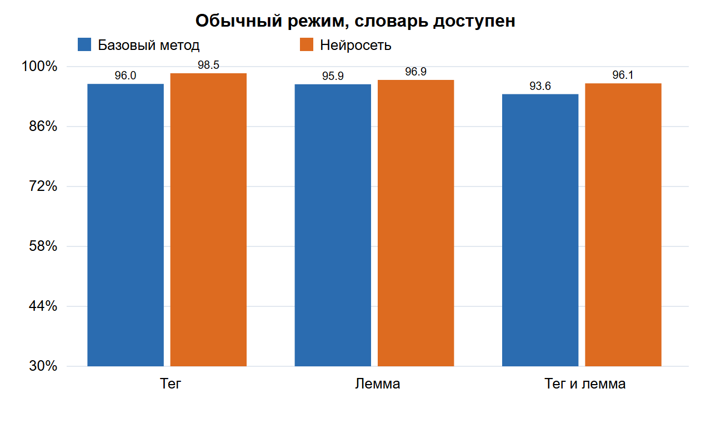
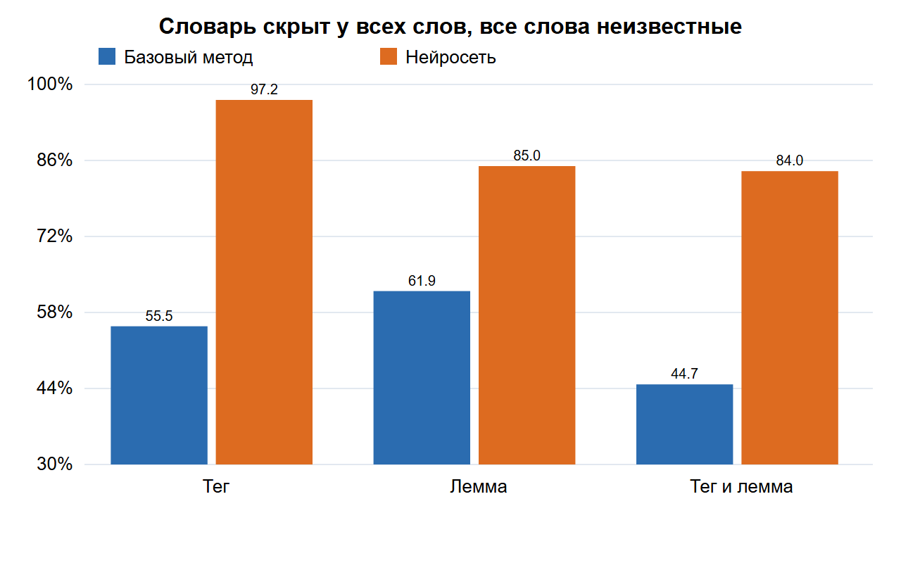
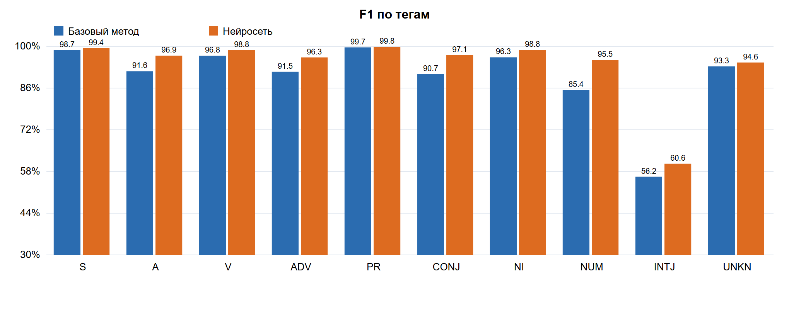
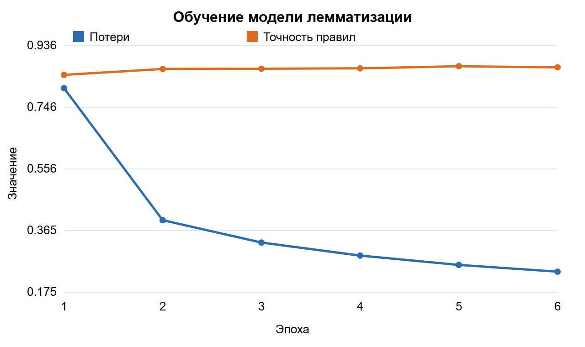
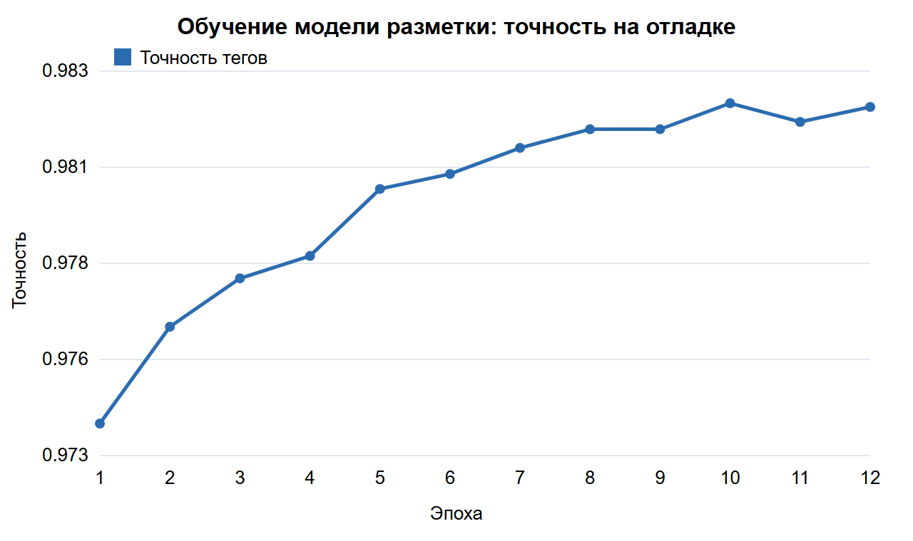
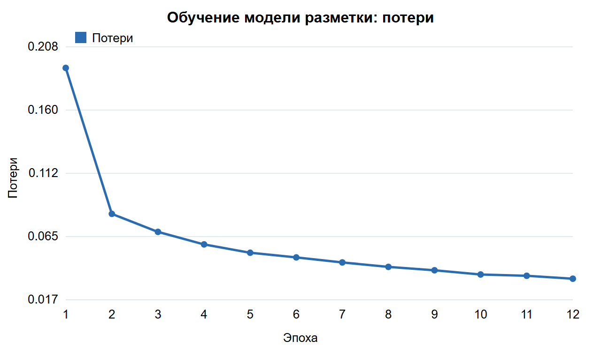

# Результаты обучения и оценки

Файл создан автоматически командой `python -m lab1 report`.

## Обучение модели разметки

| Эпоха | Потери | Точность тегов на отладке |
|---|---|---|
| 1 | 0.1921 | 97,39% |
| 2 | 0.0817 | 97,65% |
| 3 | 0.0681 | 97,78% |
| 4 | 0.0586 | 97,84% |
| 5 | 0.0523 | 98,02% |
| 6 | 0.0488 | 98,06% |
| 7 | 0.0450 | 98,13% |
| 8 | 0.0416 | 98,18% |
| 9 | 0.0391 | 98,18% |
| 10 | 0.0359 | 98,25% |
| 11 | 0.0349 | 98,20% |
| 12 | 0.0327 | 98,24% |

## Обучение модели лемматизации неизвестных слов

| Эпоха | Потери | Точность правил на контроле |
|---|---|---|
| 1 | 0.8051 | 84,62% |
| 2 | 0.3975 | 86,43% |
| 3 | 0.3284 | 86,54% |
| 4 | 0.2880 | 86,62% |
| 5 | 0.2591 | 87,29% |
| 6 | 0.2383 | 86,96% |

## Сравнение методов на тестовой части

### Обычный режим, словарь доступен

| Метод | Группа слов | Слов | Тег | Лемма | Тег и лемма |
|---|---|---|---|---|---|
| Базовый метод | Все слова | 128086 | 95,95% | 95,89% | 93,57% |
| Базовый метод | Слова, найденные в словаре | 119809 | 97,23% | 97,46% | 95,54% |
| Базовый метод | Слова без словаря | 6339 | 80,28% | 65,06% | 64,03% |
| Базовый метод | Числа | 1938 | 68,47% | 99,79% | 68,27% |
| Нейросеть | Все слова | 128086 | 98,45% | 96,89% | 96,08% |
| Нейросеть | Слова, найденные в словаре | 119809 | 98,73% | 97,76% | 97,04% |
| Нейросеть | Слова без словаря | 6339 | 93,75% | 79,57% | 78,02% |
| Нейросеть | Числа | 1938 | 96,23% | 99,79% | 96,03% |

### Словарь скрыт у всех слов, все слова неизвестные

| Метод | Группа слов | Слов | Тег | Лемма | Тег и лемма |
|---|---|---|---|---|---|
| Базовый метод | Все слова | 128086 | 55,46% | 61,93% | 44,74% |
| Базовый метод | Слова без словаря | 126148 | 55,26% | 61,34% | 44,38% |
| Базовый метод | Числа | 1938 | 68,47% | 99,79% | 68,27% |
| Нейросеть | Все слова | 128086 | 97,15% | 84,97% | 84,02% |
| Нейросеть | Слова без словаря | 126148 | 97,15% | 84,74% | 83,82% |
| Нейросеть | Числа | 1938 | 96,96% | 99,79% | 96,75% |

### Качество по тегам, обычный режим

| Тег | Слов | Точность | Полнота | F1 нейросети | F1 базового метода |
|---|---|---|---|---|---|
| S | 41975 | 99,48% | 99,24% | 99,36% | 98,73% |
| A | 14112 | 96,08% | 97,73% | 96,90% | 91,65% |
| V | 20011 | 98,97% | 98,54% | 98,75% | 96,83% |
| ADV | 12697 | 96,79% | 95,80% | 96,29% | 91,47% |
| PR | 15063 | 99,84% | 99,84% | 99,84% | 99,65% |
| CONJ | 8739 | 96,46% | 97,71% | 97,08% | 90,66% |
| NI | 12831 | 98,88% | 98,71% | 98,80% | 96,33% |
| NUM | 2324 | 95,25% | 95,70% | 95,47% | 85,35% |
| INTJ | 23 | 100,00% | 43,48% | 60,61% | 56,25% |
| UNKN | 311 | 96,64% | 92,60% | 94,58% | 93,29% |

## Графики

